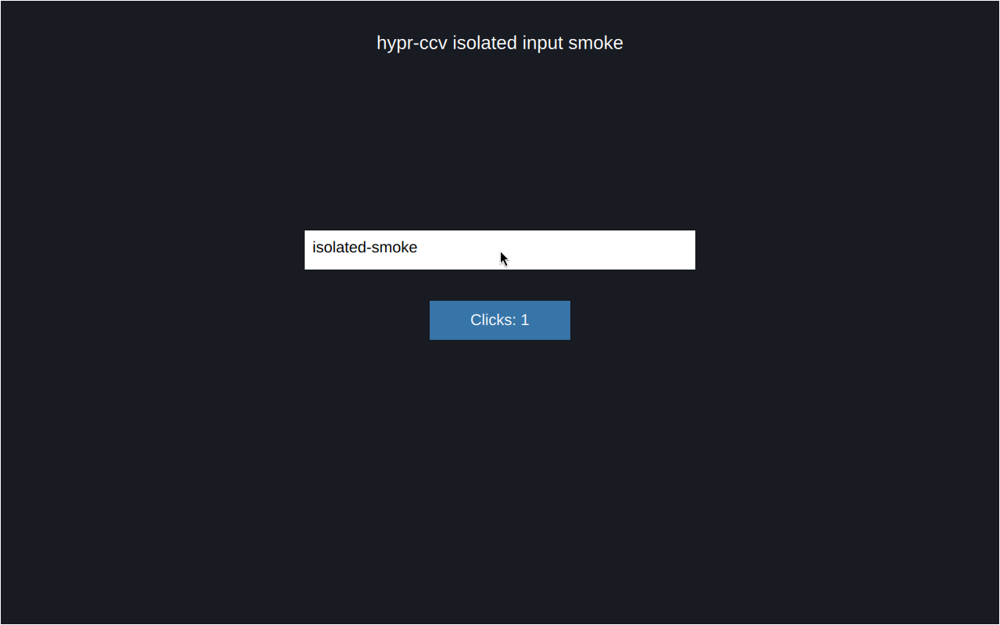

# Hyprland Computer Control

Two native Wayland skills for Codex, Claude Code and other agents:

- **hypr-cc:** control the user's existing desktop. Its real-seat input is not isolated.
- **hypr-ccv:** test GUI flows under a separate Hyprland 0.56+ compositor with private HOME, XDG roots, Wayland/IPC, clipboard and D-Bus. Bootstrap through the existing Wayland session, then use 1–4 headless outputs.

This is GUI/profile isolation, not a container or an OS security sandbox. Commands retain the user's filesystem permissions. A nested window can briefly map during bootstrap. The controller does not install host window rules, change host monitor config, reload the host compositor or inject kernel-seat input.

## Install

From this checkout:

```bash
./setup.sh --sandbox-only
# Or ./setup.sh to link both skills.
# Explicit dependency install, only if needed:
./hypr-ccv/scripts/install.sh
```

Installation links the canonical skill folders into `~/.agents/skills`, `~/.codex/skills` (or `$CODEX_HOME/skills`) and `~/.claude/skills`, plus CLI links in `~/.local/bin`. Existing nonmatching files/directories are preserved. Updates to this checkout therefore update every linked agent. Start a new agent session to refresh its skill catalog.

Sandbox dependencies: Hyprland with Lua config (0.56+), Python, hyprctl, wtype, grim, dbus-daemon and wayvnc. Clipboard commands need wl-clipboard; recordings need ffmpeg. `CC_VNC=0` omits pointer support. The direct-desktop `hypr-cc` skill has its own prerequisites; sandbox installation does not configure ydotool or uinput.

## Isolated GUI workflow

```bash
export CC_SESSION=gui-test
hypr-ccv start 1280x800 2
hypr-ccv status
hypr-ccv run quickshell -p /path/to/test-shell
hypr-ccv hypr -j clients
hypr-ccv shot /tmp/before.png
# Inspect the image, then act on observed controls.
hypr-ccv click 640 400
hypr-ccv type 'test data'
hypr-ccv key Return
hypr-ccv keys -M ctrl -k a -m ctrl
hypr-ccv snapshot /tmp/runtime.json
hypr-ccv shot /tmp/after.png
hypr-ccv record /tmp/flow.mp4 25
hypr-ccv stop
```

`run` detaches; `exec` waits. The controller finds its compositor by launched PID, checks start time/signature/socket before operations, and fails closed when state is stale. `CC_SESSION` supports independent named sessions. Multiple possible parent sessions require `CC_PARENT_SIG` or an unambiguous `WAYLAND_DISPLAY`.

Pointer input uses a private Unix socket to wayvnc, capturing `HEADLESS-1`. Coordinates are output-local pixels and validated against the negotiated framebuffer size; screenshot another output with `shot PATH OUTPUT`. A changed output geometry requires a new observation. VNC does not listen on a TCP port by default. `vnc` prints the private Unix endpoint.

`stop` and `doctor` terminate only current-user processes with the session's exact run marker/private runtime, plus matching PID start times. They retain logs, profiles, screenshots and recording frames under the printed runtime directory for review. Missing state does not trigger a global process sweep. Preserve useful evidence before logout removes the runtime directory.

Private D-Bus excludes the host's login/service state. A systemd user service or authenticated app needing the real session requires an explicit integration design; GUI isolation alone does not authorize sharing credentials or services.

## Verification

```bash
python -m unittest discover -s tests -p 'test_*.py' -v
python tests/smoke.py
```

The live smoke boots two headless outputs, launches a real Qt GUI, verifies pointer click and entered text, checks private clipboard, captures a PNG and a three-second MP4, stops the session, and asserts the parent's monitor geometry/config checksum did not change. It requires quickshell and ffmpeg in addition to the sandbox dependencies. Tests use fresh named sessions.

The April 2026 helper assumed Hyprland 0.54, legacy `.conf`, one output, shared profiles and TCP VNC. The current launcher uses Lua config and separately verifies frame delivery. Prior claims that headless outputs were impossible are not universal: nested bootstrap plus headless outputs was verified on Hyprland 0.56.2.

Verified on October 12, 2026: Hyprland 0.56.2, Qt 6.11.2, two 1280×800 headless outputs; 11 unit tests and the live GUI smoke passed. [Validation record](docs/validation.json) · [Three-second capture](docs/gui-smoke.mp4).



## Skill improvement

[hypr-ccv/SKILL.md](hypr-ccv/SKILL.md) routes agents through [verified lessons](hypr-ccv/references/lessons.md) and [the learning procedure](hypr-ccv/references/learning.md). After a demonstrated failure/fix, an agent can update concise local lessons and appropriate regression coverage. Unconfirmed causes stay labelled; no unattended service, background model invocation or automatic remote push is installed.

## License

MIT — see [LICENSE](LICENSE).
